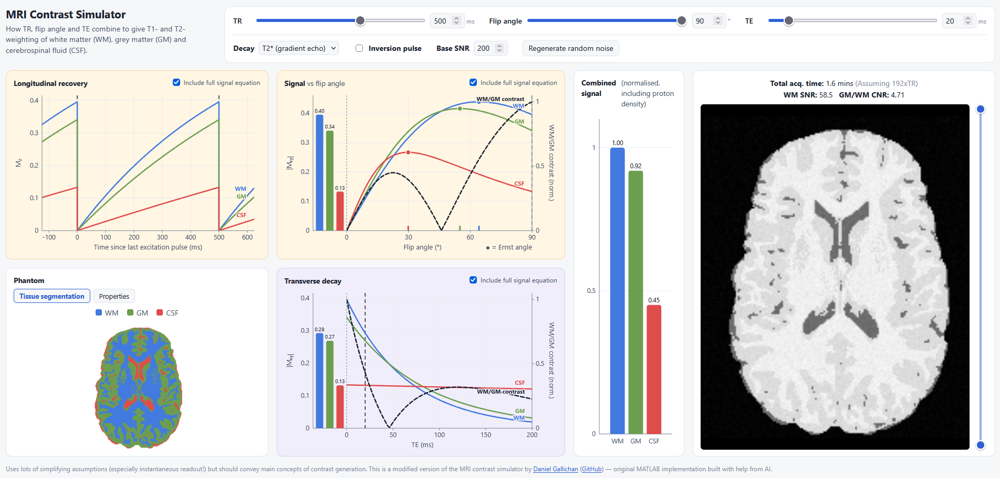

# MRI Simulations

This is a fork of [Daniel Gallichan's teaching-aids repository](https://github.com/dangallichan/teaching-aids),
in which the [MRI contrast simulator](https://dangallichan.github.io/teaching-aids/simContrast.html)
has been modified and extended (original MATLAB implementation built with help from AI).

**What has changed in the MRI contrast simulator:**

- **Full signal equations per figure:** each figure (longitudinal recovery, signal vs flip angle, transverse decay) has an
  "Include full signal equation" tick. When enabled, the T1 panels fold in proton density, and the T2 decay curves start
  from the current T1-stage signal instead of from full magnetisation.
- **Phantom panel:** the tissue segmentation now lives in a "Phantom" card with two tabs. The *Properties* tab holds the
  field strength (1.5 T / 3 T presets or a Manual mode), the proton density toggle, and the tissue values table —
  T1, T2, T2* and PD for WM, GM and CSF are editable in Manual mode.

---

The other teaching tools in this repository (phase encoding, FFT visualisation, magnetisation signal, etc.) are unmodified
from the original — see the [upstream teaching-aids](https://github.com/dangallichan/teaching-aids) for details.
